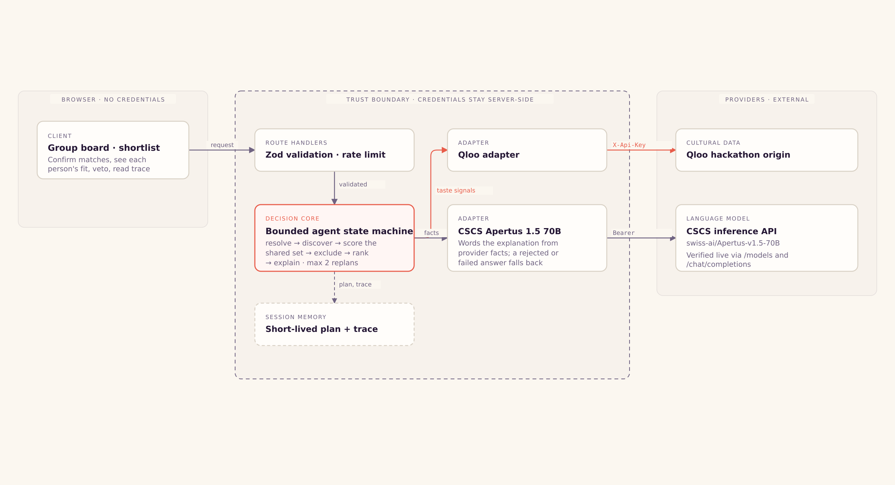

# Encore Commons

**Different tastes. One great night.**

A Qloo-powered agent that helps friends with very different cultural tastes agree
on a pre- or post-show venue. It resolves each person's favourite artist, film,
book or podcast to real Qloo entities, discovers places near the show, scores
**every** place for **every** person on the same evidence, ranks
worst-participant-first, explains the result from provider facts, and replans when
someone vetoes.

Not another single-user recommendation list. The product is the *agreement*.

## Status

| | |
| --- | --- |
| Application | **Built.** Typechecks, builds, serves, and has been driven end to end over real HTTP. |
| Qloo | **Live.** `GET /search`, `GET /v2/insights`, `GET /v2/tags` against `https://hackathon.api.qloo.com`. |
| CSCS Apertus 1.5 70B | **Live.** `/v1/models` and `/v1/chat/completions` verified; model pinned at 70B. |
| Sites runtime | **Verified.** `vinext check` → 91% compatible, 0 issues; `vinext build` → exit 0; `vinext dev` served every route and ran a real plan. |
| Tests | **70 tests, 8 files, passing.** Plus 16 live smoke checks and a 3-strategy ablation. |
| Public URL | **Live: <https://encore.yablokolabs.com>** — verified signed out from the open internet, 31/31 checks. |
| Demo video | **Produced.** 115.8 s narrated walkthrough in [docs/media](docs/media/), built from real captures of the running app. |
| Voice | **Deviation disclosed.** The brief asked for a youthful adult British female voice; the account's free tier has no such premade voice and refuses library voices with HTTP 402, so the closest permitted British female voice was auditioned and used. See [docs/TOOLING_STATUS.md](docs/TOOLING_STATUS.md). |

One thing is deliberately not claimed: the public host is a named Cloudflare
tunnel on this account's own zone, **not** a Sites Worker deployment — publishing
to Workers needs a Cloudflare account credential this environment does not hold.
[docs/DEPLOYMENT.md](docs/DEPLOYMENT.md) states the difference rather than
glossing over it.

## Architecture



The full diagram is also available as [standalone SVG](docs/architecture.svg) and
as [self-contained HTML](docs/architecture.html). The one thing to notice: the
credential boundary. Provider keys exist only inside the server route handlers —
the browser never receives one, and the two adapters are the only code that reads
them.Every node in the diagram is implemented, and all of them are exercised by the test suite, the live smoke test or the Vinext runtime check. **The hosted deployment is the one thing that is not done**, and it is tracked as an open blocker rather than glossed over.

### How a plan is produced

```
collect → resolve → confirm → query each profile → union candidates
        → evaluate the shared set → apply exclusions → rank → explain
```

Each step is a bounded tool call, validated on the way in and on the way out.
Five allowlisted tools: `search_entities`, `query_places`, `score_candidates`,
`apply_veto`, `explain_plan`. Ceilings: 40 tool calls, 2 replans, per-request
deadlines.

## Why Qloo is load-bearing

Qloo returns a numeric affinity for each candidate venue against a given signal
set, and `filter.results.entities` lets us request affinity for one **shared**
candidate set across every participant. That is what makes a fair comparison
possible at all.

Measured live on the demo group:

- **24 of 24 candidates scored for all 3 participants — 100% coverage.**
- Real divergence: Ada's, Bo's and Cy's individually best places are three
  *different* venues.
- Top pick: `Absinthdepot Berlin`, worst-person affinity **0.792977**, mean
  **0.822006** — with Ada 0.836, Bo 0.793, Cy 0.837.

The ranking itself contains no model call. `packages/domain/src/ranking.ts` is
deterministic arithmetic you can read and test. A language model only words the
explanation afterwards, from facts that are already fixed.

## Run it locally

```bash
npm ci
cp .env.example .env.local     # then fill in the two provider keys
npm run dev                    # http://localhost:3000
```

Or the production path, which is what was verified:

```bash
npm run build && npm start
```

Then open the app, click **Use the demo group (Berlin)**, resolve the favourites,
and find a venue. Veto an alternative to watch the replan.

### Commands

| Command | What it does |
| --- | --- |
| `npm run typecheck` | `tsc --noEmit` |
| `npm test` | 70 tests. Runs without credentials against recorded fixtures. |
| `npm run smoke` | 16 live checks against the real Qloo and CSCS endpoints |
| `npm run record` | Re-records the replay fixtures from live Qloo |
| `npm run evaluate` | The ablation; add `--live-qloo` for live provider calls |
| `npm run build` / `npm start` | Production build and server |
| `npm run vinext:check` | Vinext compatibility check for the Sites target |
| `npm run vinext:build` / `npm run vinext:dev` | Build and run on the Sites (Vinext) runtime |

### Credentials

Set these as **runtime secrets** on the hosted deployment — a hosted app cannot
read a local env file:

| Name | Purpose |
| --- | --- |
| `QLOO_API_KEY` | Hackathon key, sent only as `X-Api-Key` to the Qloo origin |
| `CSCS_INFERENCE_API_KEY` | Apertus 1.5 70B wording |

`CSCS_MODEL` defaults to `swiss-ai/Apertus-v1.5-70B` and is never downgraded.
Values are never logged, returned, packaged or committed. `.env.example` documents
names only.

## API

| Route | Purpose |
| --- | --- |
| `GET /api/health` | Credential *presence*, provider mode, origin and model. No values. |
| `POST /api/search` | Resolve a favourite to Qloo entities for the confirm step |
| `POST /api/plan` | Build a plan: resolve, discover, score the shared set, rank, explain |
| `GET /api/plan?sessionId=` | Retrieve a stored plan and its trace |
| `POST /api/veto` | Apply a hard exclusion and replan from cached discovery |
| `DELETE /api/plan?sessionId=` | Delete the session |

Write routes enforce a per-client rate limit and a 32 KB body cap before any
provider call.

## What this does not claim

Read these as part of the product, not as a disclaimer.

- **Affinity is cultural fit, not enjoyment.** A Qloo affinity is a relative
  signal between confirmed favourites and a venue. It is not a probability that
  anyone will have a good night, and it is not calibrated to any individual.
- **Distance is straight-line.** It is not a walking route and not a travel time.
- **Provider metadata is unverified.** Opening hours, price, ratings, step-free
  access, allergy handling and availability are third-party metadata or simply
  unknown. Every one is labelled `verified: false` and listed as needing
  confirmation with the venue.
- **Nothing is booked.** No reservation, ticket, payment or calendar write.
- **No traits are inferred.** Participants are pseudonymous labels. Taste is never
  used to infer age, gender, health or any demographic attribute.
- **Taste-seeded discovery has a genre bias.** Near Berlin it surfaced mostly
  museums, memorials and galleries rather than nightlife. Reported in
  [docs/EVALUATION.md](docs/EVALUATION.md) with the numbers.
- **No user study was run,** so no impact on group satisfaction is claimed.

## Evaluation, honestly

Three strategies on the same frozen inputs (`docs/EVALUATION.md`,
`fixtures/evaluation.json`):

| Metric | Qloo-grounded | Popularity only | Unguided Apertus 70B |
| --- | --- | --- | --- |
| Worst-person affinity | **0.792977** | 0.771924 | 0.756098 |
| Mean affinity | 0.822006 | **0.831708** | 0.784861 |
| Agreement rate | 0.667 | **1.000** | — |

The Qloo-grounded plan wins on the metric the product exists to optimise. The
popularity baseline **wins on agreement**, and that is reported rather than
hidden. The unguided model named five real Berlin venues that all resolved in
Qloo — and three of them had no comparable affinity at all for this group.

| --- | --- |
| [docs/API_CONTRACT.md](docs/API_CONTRACT.md) | Every verified route, header, parameter, limit and sanitised sample |
| [docs/DECISIONS.md](docs/DECISIONS.md) | Ten decisions with the evidence that settled each, plus open items |
| [docs/EVALUATION.md](docs/EVALUATION.md) | Test inventory, live smoke results, the ablation and where Qloo was unhelpful |
| [docs/DEPLOYMENT.md](docs/DEPLOYMENT.md) | Deployment target, verified local production run, secrets, checklist, blockers |
| [docs/PROGRESS.md](docs/PROGRESS.md) | Checkpoints, including the five bugs the tests found |
| [docs/TOOLING_STATUS.md](docs/TOOLING_STATUS.md) | Which tools and skills were verified, and which are still pending |
| [docs/DEVPOST_PROJECT_STORY.md](docs/DEVPOST_PROJECT_STORY.md) | The submission write-up |
| [docs/BUILT_WITH.md](docs/BUILT_WITH.md) | Only the technologies genuinely used, with evidence |
| [docs/BRANDING.md](docs/BRANDING.md) | Branding asset provenance |
| [docs/LICENSE_THIRD_PARTY.md](docs/LICENSE_THIRD_PARTY.md) | Third-party data and service terms |

## Demo video

**[docs/media/encore-commons-demo.mp4](docs/media/encore-commons-demo.mp4)** — 115.8 seconds,
1920×1080, narrated. Captions ship alongside it as
[WebVTT](docs/media/encore-commons-demo.en.vtt) and [SRT](docs/media/encore-commons-demo.en.srt).

Seven scenes: the group and its disagreement, the group board with the human
confirmation step, the allowlisted agent with one run's measured counts, the
proposal with every participant's own score, a veto and what the replan actually
cost, the trace as the receipt, and the limits the project states about itself.

The interface in the film is **recorded, not redrawn**: `videos/scripts/capture-app.mjs`
drives the running application in Chromium and the scenes use those frames. Every
figure quoted on screen was read back out of the DOM of the run being filmed, so
none of it is retyped from a different session.

Two things the film states plainly rather than smoothing over: affinity is a
relative provider signal and **not** a probability of enjoyment, and the veto in it
was cast against an alternative — so the proposal did not move, and the film's claim
is the one the evidence supports, that a veto is a hard exclusion and the replan
issued zero new Qloo calls.

The video project is isolated under `videos/` and shares nothing with the Sites app.
`npm run check` inside it runs three real checks: the derived advance timings agree
with the recorded narration, the narration and the script agree with each other, and
every scene fits the frame with the brand faces actually loaded.

## Project layout

```text
app/                      Next.js App Router routes and API handlers
  api/{health,search,plan,veto}/
components/               Shared UI pieces
lib/
  agent/                  The bounded state machine and trace recorder
  qloo/                   Server-side Qloo adapter, error taxonomy, replay
  cscs/                   Apertus adapter and grounded explanation
  storage/                Short-lived in-memory session store
  http/                   Request guards and rate limiting
packages/domain/src/      Pure domain logic: schemas, ranking, evidence, geo, safety
fixtures/
  replay/                 Genuinely recorded, sanitised Qloo responses for tests
  contract/               Sanitised live samples for docs
  evaluation.json         Raw ablation output
scripts/                  record / smoke / evaluate
tests/                    unit and integration suites
docs/                     Documentation and the architecture diagram
```

## Licence

[MIT](LICENSE) — the source code and the branding assets generated for this
project.

Third-party data and services are **not** covered by that licence. Qloo entity
data and affinity values, and CSCS Apertus inference, belong to their providers,
and the recorded fixtures are a sanitised test subset rather than a redistributed
dataset. The full terms, including how to remove the fixtures if those terms
require it, are in [docs/LICENSE_THIRD_PARTY.md](docs/LICENSE_THIRD_PARTY.md).

## Documentation

| Document | Contents |
